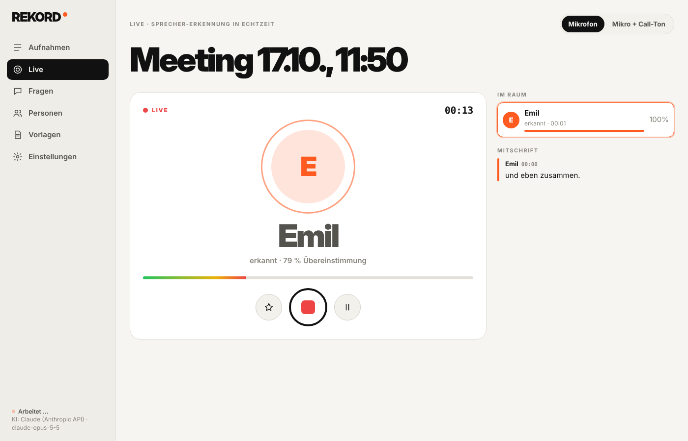
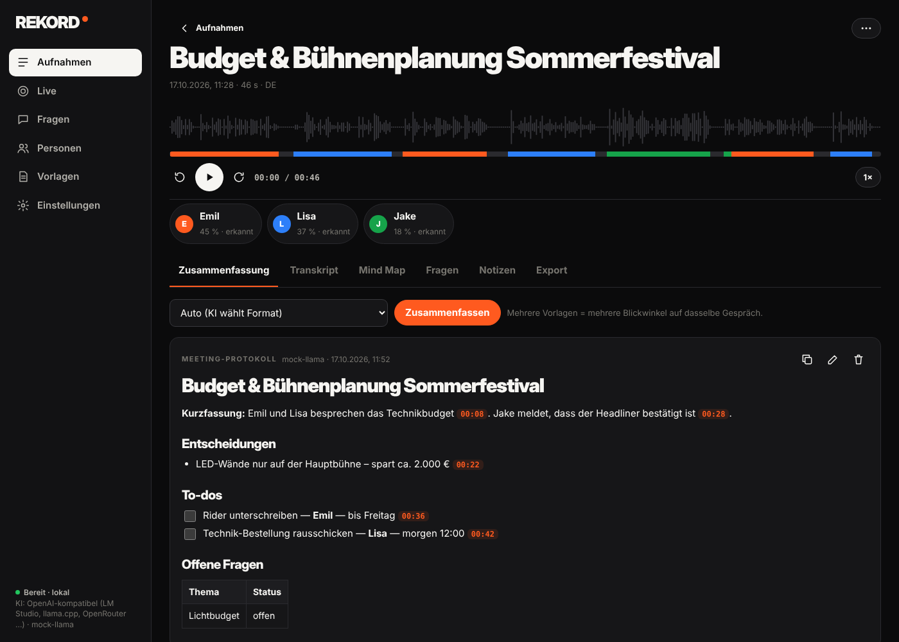
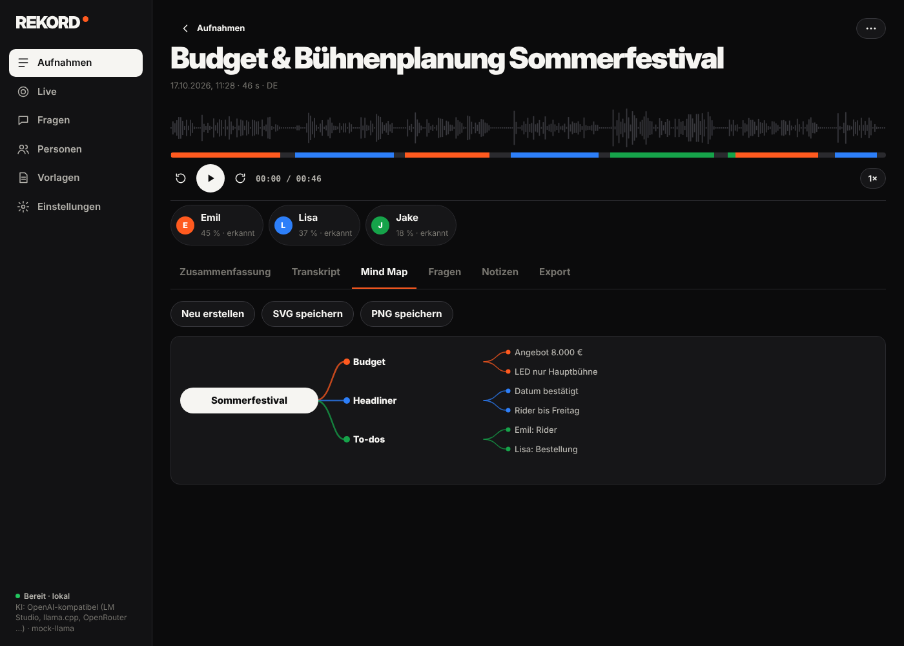
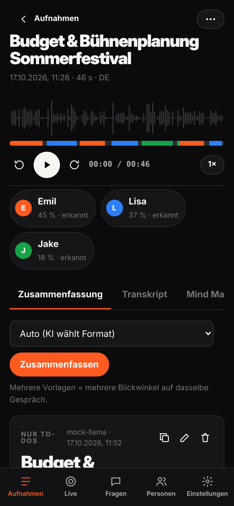

# REKORD.

**Du redest. REKORD schreibt mit.**

REKORD ist eine kostenlose App für deinen Computer (und optional dein iPhone). Du nimmst ein Gespräch auf – ein Meeting, eine Besprechung, ein Interview, einen Teams- oder Zoom-Call. REKORD schreibt dann **alles auf, was gesagt wurde**, zeigt **wer was gesagt hat** und macht dir daraus ein **fertiges Protokoll mit To-dos**.

Kein Konto. Kein Abo. Deine Aufnahmen bleiben **auf deinem Computer**.

| Während des Meetings: wer spricht gerade | Danach: das Protokoll | Alles als Mind Map | Auch am iPhone |
|---|---|---|---|
|  |  |  |  |

---

## Was macht REKORD genau?

Stell dir vor, neben dir sitzt jemand, der in jedem Meeting mitschreibt – und sich alle Stimmen merkt.

1. **Du drückst auf den roten Knopf.** REKORD fragt kurz, wie viele Leute dabei sind und ob ihr im selben Raum sitzt oder online (Teams, Zoom …).
2. **Ihr redet ganz normal.** Auf dem Bildschirm steht groß, wer gerade spricht.
3. **Du drückst Stopp.** Ein paar Minuten später hast du:
   - den **ganzen Text** des Gesprächs (das nennt man *Transkript*),
   - bei jedem Satz den **Namen**, wer ihn gesagt hat,
   - eine **Zusammenfassung**: Was wurde besprochen? Was wurde entschieden? Wer muss bis wann was erledigen?
4. **Später fragst du einfach nach**, z. B. *„Was hat Lisa letzte Woche zum Budget gesagt?“* – REKORD sucht in allen deinen Aufnahmen und zeigt dir die Stelle.

REKORD lernt Stimmen: Wer einmal ca. 45 Sekunden einen Text vorgelesen hat, wird ab dann in jedem Meeting mit Namen erkannt.

---

## Was brauche ich?

- **Einen Computer:** Mac mit Apple-Chip (M1 oder neuer), Windows 10/11 oder Linux.
  *Mac prüfen:* Apfel-Menü  → *Über diesen Mac* → bei „Chip“ steht *Apple M…*
- **Ca. 2 GB freien Speicher** – mit der kostenlosen lokalen KI zusätzlich 3–6 GB. Am besten **8 GB Arbeitsspeicher** oder mehr.
- **Ein Mikrofon** – das eingebaute reicht. Ein Headset oder Konferenz-Mikro wird genauer.
- **Internet nur beim ersten Start** (REKORD lädt einmal ca. 700 MB). Danach geht alles offline.
- Optional: ein **iPhone**, wenn du auch unterwegs aufnehmen willst.

---

## Installieren – Schritt für Schritt

Du musst nichts verstehen, nur **eine Zeile kopieren und einfügen**. Das dauert ca. 5 Minuten.

### Mac

1. Drück **⌘ (Command) + Leertaste**, tippe **Terminal** und drück **Enter**. Es öffnet sich ein Fenster mit Text – keine Sorge, das ist normal.
2. Fahr mit der Maus über den grauen Kasten hier unten. Rechts erscheint ein **Kopieren-Symbol** ⧉ – anklicken.
   ```
   curl -fsSL https://github.com/KimJongUnNK/rekord/releases/latest/download/install.sh | sh
   ```
3. Klick ins Terminal-Fenster, drück **⌘ + V** (einfügen) und dann **Enter**.
4. Warten, bis REKORD von selbst aufgeht. Fertig – es liegt jetzt in deinem Ordner **Programme**.

### Windows

1. Drück die **Windows-Taste**, tippe **PowerShell** und drück **Enter**. Es öffnet sich ein (blaues oder schwarzes) Fenster mit Text.
2. Kopier diese Zeile (Kopieren-Symbol ⧉ rechts im grauen Kasten):
   ```
   irm https://github.com/KimJongUnNK/rekord/releases/latest/download/install.ps1 | iex
   ```
3. **Rechtsklick** ins PowerShell-Fenster (das fügt ein) und **Enter** drücken.
4. Warten, bis REKORD aufgeht. Du findest es danach im **Startmenü** und auf dem **Desktop**.
   Fragt Windows nach der Firewall: **„Private Netzwerke“** anhaken → **Zugriff zulassen** (nur wichtig fürs iPhone).

### Linux

Terminal öffnen (meist **Strg + Alt + T**), dieselbe Zeile wie beim Mac einfügen, **Enter**. Linux fragt einmal nach deinem Passwort.

> **Warum eine Zeile statt Doppelklick?** Apple und Microsoft warnen bei Apps, für die der Entwickler kein kostenpflichtiges Zertifikat gekauft hat. REKORD ist kostenlos und quelloffen – die Zeile installiert es ohne diese Warnungen.
> Lieber klassisch herunterladen? → **[Download-Seite](https://github.com/KimJongUnNK/rekord/releases/latest)** und die **[ausführliche Anleitung](docs/ANLEITUNG.md)**.

---

## Der erste Start

REKORD führt dich durch alles – jeden Schritt kannst du überspringen und später ändern:

1. **Wo soll gespeichert werden?** Einfach den **eingebauten** Speicher lassen – oder eine externe Festplatte wählen.
2. **Aussehen und Sprache** aussuchen.
3. **Mikrofon testen:** etwas sagen, der Balken muss ausschlagen.
4. **KI wählen** – die schreibt die Zusammenfassungen (siehe unten). Wenn du unsicher bist: **Lokal · gratis**.
5. **Deine Stimme einsprechen:** Namen eingeben, den Text vorlesen, der erscheint. Ab dann steht dein Name in jedem Meeting.

Überall, wo ein kleines **ⓘ** steht, kannst du mit der Maus drüberfahren (am Handy: antippen) – dort steht in einfachen Worten, was es macht.

### Welche KI soll ich nehmen?

Die KI liest den Text deines Meetings und schreibt daraus das Protokoll. Du hast drei Möglichkeiten:

| | Was es heißt | Kosten |
|---|---|---|
| **Lokal · gratis** | Die KI läuft direkt auf deinem Computer. **Nichts** verlässt den Computer. Ein Klick, REKORD richtet alles selbst ein. | **0 €** |
| **Claude** oder **ChatGPT** | Etwas bessere Texte. Der Text des Meetings (nie die Aufnahme selbst) geht dafür an Anthropic bzw. OpenAI. Du brauchst einen *API-Key* (siehe unten). | ein paar Cent pro Meeting |
| **Ohne KI** | Du bekommst trotzdem den ganzen Text und wer was gesagt hat – nur keine Zusammenfassung. | 0 € |

---

## Deine erste Aufnahme

1. Großer **roter Knopf** (oder **Leertaste**).
2. REKORD fragt **„Wer ist dabei?“**:
   - **Vor Ort** (alle im selben Raum) oder **Online** (Teams, Zoom, Meet …). Bei *Online* nimmt REKORD auch die Stimmen der anderen aus dem Call auf – direkt am Computer, auch mit Kopfhörern.
   - **Wie viele sprechen?** (dich mitgezählt)
   - **Wer davon ist bekannt?** – Namen antippen.
3. **Aufnahme starten** – und ganz normal reden.
4. **Stopp** drücken. Nach ein paar Minuten ist das Protokoll fertig.
5. Hat REKORD jemanden nicht erkannt, fragt es **„Wer ist das?“**: kurz anhören, Namen eintippen, *Merken*. Beim nächsten Mal weiß es Bescheid.

> **Wichtig:** Sag allen vorher, dass du aufnimmst, und frag, ob das okay ist. Heimlich aufnehmen ist in vielen Ländern verboten (z. B. in Deutschland) – und fair ist es sowieso.

---

## Häufige Fragen

**Kostet das wirklich nichts?**
Ja. REKORD ist kostenlos, ohne Abo und ohne Minutenlimit. Kosten entstehen nur, wenn *du* Claude oder ChatGPT auswählst – dann zahlst du dort ein paar Cent pro Meeting. (Ein ChatGPT-Plus-Abo zählt dafür leider nicht.)

**Wo landen meine Aufnahmen? Hört da jemand mit?**
Alles bleibt auf deinem Computer – im Ordner, den du beim ersten Start gewählt hast. Es gibt kein Konto, keine Cloud, keine Werbung, kein Tracking. Nur wenn du Claude oder ChatGPT nutzt, geht der **Text** (nicht die Aufnahme) dorthin.

**Was ist ein API-Key?**
Eine Art Passwort, mit dem REKORD die KI von Claude oder ChatGPT benutzen darf. In REKORD gibt es einen Knopf **„Key erstellen ↗“**, der dich direkt auf die richtige Seite bringt. Dort anmelden, Key erstellen, kopieren, in REKORD einfügen – REKORD testet sofort, ob er passt. Mit *Lokal · gratis* brauchst du gar keinen.

**Geht das mit Teams, Zoom, Google Meet?**
Ja. Vor der Aufnahme **Online** wählen. Am Mac fragt macOS beim ersten Mal nach *„Bildschirm- & Systemaudioaufnahme“* – erlauben. Es wird nur der Ton aufgenommen, kein Bild.

**Kann ich mit dem iPhone aufnehmen?**
Ja. In REKORD am Computer: *Einstellungen → iPhone & Geräte* → QR-Code mit dem iPhone scannen. Das iPhone und der Computer müssen im selben WLAN sein.

**Welche Sprachen versteht REKORD?**
Rund 99 Sprachen, auch gemischt im selben Gespräch. Am genauesten, wenn du die Sprache in den Einstellungen fest einstellst.

**Wie bekomme ich Updates?**
Gibt es eine neue Version, steht links in REKORD *„Update auf … →“*. Ein Klick – REKORD lädt sie, ersetzt die alte Version und startet neu. Deine Aufnahmen bleiben.

**Etwas klappt nicht.**
Schau in **[Wenn was nicht klappt](docs/ANLEITUNG.md#wenn-was-nicht-klappt)** – dort stehen die häufigsten Probleme mit Lösung. Sonst: **[Problem melden](https://github.com/KimJongUnNK/rekord/issues/new)** (kostenloses GitHub-Konto nötig).

---

## Wörter, die du hier liest

| Wort | Heißt einfach |
|---|---|
| **Transkript** | Der komplette Text von allem, was gesagt wurde. |
| **Zusammenfassung / Protokoll** | Das Wichtigste in kurz: Themen, Entscheidungen, To-dos. |
| **KI** | Künstliche Intelligenz – hier: das Programm, das aus dem Text das Protokoll schreibt. |
| **Lokal** | Läuft direkt auf deinem Computer, ohne Internet. |
| **Einsprechen** | Einmal einen Text vorlesen, damit REKORD deine Stimme kennt. |
| **Terminal / PowerShell** | Ein Fenster, in das man Befehle tippt. Du brauchst es nur einmal zum Installieren. |
| **Open Source / quelloffen** | Jeder kann den Bauplan (den Code) ansehen. Nichts ist versteckt. |

---

# Für Technik-Interessierte

Alles ab hier brauchst du zum Benutzen **nicht**.

## Was es kann – im Vergleich zu Plaud Note Pro

| | Plaud Note Pro | **REKORD** |
|---|---|---|
| Aufnahme | eigene Hardware | iPhone, Mac, Windows, Linux, jedes Mikro (USB, Headset, AirPods, Konferenz-Speaker) |
| Transkription | Cloud | **lokal** (Whisper bis large-v3 / turbo, ~99 Sprachen, Sprache pro Satz) |
| Sprecher | „Speaker 1/2" + manuell benennen | **Erkennt Personen an der Stimme**, live und über alle Meetings hinweg |
| Live im Meeting | – | **Großanzeige „wer spricht"**, Redeanteile, Live-Mitschrift |
| Teilnehmer vorab wählen | – | **„Wer ist dabei?"**: Anzahl + Bekannte + Vor Ort/Online → geschlossene Runde, kaum Verwechslungen |
| Stimmen anlernen | – | **Einsprechen**: jede Person liest ihren eigenen Text (~45 s), REKORD prüft die Qualität |
| Zusammenfassungen | Templates, Cloud-KI | 31 Vorlagen + eigene, mehrere Blickwinkel pro Gespräch, **deine KI** |
| „Ask Plaud" | ja | **Fragen** pro Aufnahme und über alle Aufnahmen, mit klickbaren Quellen [mm:ss] |
| Mind Map | ja | ja (SVG/PNG-Export) |
| Highlight-Knopf | Hardware-Taste | ★-Button, Taste `H`, Live Activity, Siri, Action Button |
| Call-Aufnahme | Vibrationssensor | **Online-Modus**: Mikro + Ton des Calls direkt am Computer (Teams, Zoom, Meet – auch als App) |
| Export | PDF, Word, TXT … | Markdown, Word, TXT, SRT, VTT, JSON, PDF, Audio |
| Claude-Anbindung | – | **MCP-Server**: Claude Desktop/Claude Code liest deine Bibliothek, läuft mit normalem Claude-Abo |
| Lockscreen | – | **Live Activity + Dynamic Island** (aktueller Sprecher), Sperrbildschirm-Widgets, Kontrollzentrum-Button |
| Datenschutz | Cloud | Audio und Stimmabdrücke verlassen nie dein Gerät. Keine Telemetrie, kein Konto. |
| Kosten | Gerät + Abo | 0 € (lokal) bzw. nur API-Kosten deiner KI |

---

## Architektur

```
 iPhone (native App / PWA)          Mac / Windows / Linux  – „Hub"
 ┌──────────────────────┐   WLAN   ┌───────────────────────────────────────────────┐
 │ Mikro → 16 kHz PCM   │ ───────► │ Live:  VAD → Stimmabdruck → Person? → Whisper │
 │ Live Activity        │ ◄─────── │        („Lisa spricht", Mitschrift)            │
 │ Widgets · Siri       │  Events  │ Danach: pyannote-Segmentierung → Feintrennung │
 └──────────────────────┘          │        → Personen-Abgleich → Whisper → KI     │
 Browser (PWA) ───────────────────►│ SQLite + FTS5 · Audio · Modelle · ~/Rekord    │
 Claude Desktop ── MCP ───────────►│                                               │
                                   └──────────────┬────────────────────────────────┘
                                                  │ nur Text
                                    Claude API · OpenAI API · Ollama · LM Studio
```

Die gesamte Sprachverarbeitung läuft über **sherpa-onnx** (ONNX Runtime, CPU, kein PyTorch, keine GPU nötig) und damit identisch auf Windows, macOS (Intel + Apple Silicon) und Linux.
Modelle (alle offen, von GitHub): Whisper int8 (tiny → large-v3/turbo), pyannote segmentation 3.0, ERes2Net-Voiceprint, Silero VAD.
Optional: `faster-whisper` für NVIDIA-GPUs.

---

## Personen erkennen: so wird's präzise
1. **Einmal anlernen.** Dafür gibt's drei Wege:
   - *Personen → Person einsprechen*: den eigenen Text vorlesen (~45 s, mindestens 25 s).
   - *Live → Vorstellungsrunde*: Handy reihum, jede Person stellt sich kurz vor.
   - Im Meeting die **Nicht erkannte Stimme** antippen und den Namen eingeben. Ab diesem Satz wird die Person erkannt.
   - Oder nach dem Meeting bei **„Wer ist das?"** anhören, Namen eingeben, *Merken*.
2. **Vor jeder Aufnahme fragt „Wer ist dabei?"**: wie viele sprechen und wer schon bekannt ist. REKORD trennt dann genau so viele Stimmen und vergleicht nur mit diesen Leuten. Sind alle bekannt, ist es eine *geschlossene Runde*, und jede Stimme geht an die ähnlichste anwesende Person.
3. Jeder Stimmabdruck wird mit jedem Meeting besser, weil er als laufender Mittelwert über alle bestätigten Aufnahmen gebildet wird.
4. Feintuning unter *Einstellungen → Sprecher-Erkennung*: Schwellen, feste Sprecherzahl, Modell.

Nach der Aufnahme läuft ein zweiter, gründlicher Durchgang: Segmentierung, Feintrennung schneller Sprecherwechsel, Abgleich und Transkription mit dem großen Modell. Live ist schnell, das Ergebnis danach ist genau.

---

## Bedienung
Jeder Menüpunkt, jeder Reiter und jede Einstellung ist in der **[Anleitung, Abschnitt 6](docs/ANLEITUNG.md#6-das-menü-jeder-punkt-erklärt)** erklärt.
Kurz: **Leertaste** startet/stoppt im Live-Modus, **H** markiert einen Moment (★). ★-Stellen gewichtet die KI stärker.

## Daten
Alles liegt in `~/Rekord` (änderbar per `REKORD_HOME`): `rekord.db` (SQLite), `audio/`, `models/`, `inbox/`, `settings.json`. Für ein Backup kopierst du diesen Ordner.
Im WLAN ist jeder Zugriff außer von localhost durch einen **Kopplungs-Code** geschützt, und das Rotieren des Codes trennt alle Geräte.

## Entwicklung

**Aus dem Quellcode starten** (Python 3.10+):
```bash
git clone https://github.com/KimJongUnNK/rekord && cd rekord
./start.sh --host 0.0.0.0        # macOS/Linux · Windows: .\start.ps1 --host 0.0.0.0
```

**CLI:** `rekord serve` · `rekord process datei.m4a --summary meeting` · `rekord models list|download` · `rekord enroll "Lisa" probe.m4a` · `rekord mcp`

**iOS-App selbst bauen** (Mac + Xcode): `brew install xcodegen && cd ios && xcodegen generate && open Rekord.xcodeproj`. Dann bei *Signing & Capabilities* dein Team wählen.
Ist die Bundle-ID `app.rekord.ios` vergeben, Prefix und App Group (`group.app.rekord.shared`) in beiden Targets ändern.

**Desktop-Pakete:** `pyinstaller desktop/rekord.spec`. Linux-Pakete: `packaging/linux/build.sh`. Ein Push auf den Branch `release` baut alles und veröffentlicht das Release.

**Tests:**
```bash
pip install -e ".[all,dev]"
pytest -m "not models"                                   # Unit- + API-Tests, Sekunden
python scripts/make_test_audio.py && pytest -m models    # End-to-End mit echten Modellen
```
Die Unit-Tests prüfen unter anderem die exakte Claude-API-Anfrage (gegen einen lokalen Nachbau der Anthropic-API) und den MCP-Server per echtem Protokoll-Handshake.
Die End-to-End-Tests erzeugen Meetings mit mehreren Sprechern über offene TTS-Stimmen. Sie prüfen die Diarization, die Wiedererkennung von Personen über zwei Meetings, die Live-Erkennung in Echtzeit und die geschlossene Runde.

## Grenzen (ehrlich)
- Überlappendes Sprechen (zwei gleichzeitig) wird dem dominanteren Sprecher zugeordnet.
- Sehr ähnliche Stimmen ohne Anlernen können verwechselt werden. Abhilfe: anlernen und Teilnehmer wählen.
- Das Live-Transkript nutzt das gewählte Modell auf kurzen Schnipseln. Das genaue Transkript entsteht im zweiten Durchgang.
- Die iOS-App braucht zum Bauen einen Mac mit Xcode. Live Activities laufen ab iOS 18.
- Linux-Pakete gibt's für x86_64. ARM-Boards (Raspberry Pi) und musl-Distros (Alpine) laufen aus dem Quellcode.

MIT-Lizenz · © 2026 Emil Boenke
