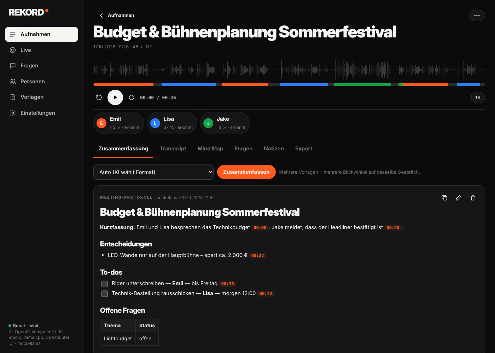

<!-- Release page text. {{VERSION}} is filled in by the release workflow (e.g. 1.4.0). Full history: docs/CHANGELOG.md -->

  

<h1 align="center">REKORD {{VERSION}}</h1>

<b>Du redest. REKORD schreibt mit.</b> 
Transkript, Sprecher und Protokoll – kostenlos, ohne Konto, alles bleibt auf deinem Computer.

  
  
  

  

---

## Schon installiert?

Nichts tun. REKORD zeigt **unten links „Jetzt aktualisieren“** – ein Klick, fertig. Kein Terminal.
Kommt der Hinweis nicht: unten links auf **Nach Updates suchen** klicken.

## Neu installieren – eine Zeile, fertig

| | So geht's |
|---|---|
| **Mac** (Apple-Chip, M1 und neuer) | Programm **Terminal** öffnen, einfügen, Enter: `curl -fsSL https://github.com/KimJongUnNK/rekord/releases/latest/download/install.sh \| sh` |
| **Windows** 10/11 | **PowerShell** öffnen (Startmenü → „PowerShell“), einfügen, Enter: `irm https://github.com/KimJongUnNK/rekord/releases/latest/download/install.ps1 \| iex` |
| **Linux** (jede Distro) | Terminal: `curl -fsSL https://github.com/KimJongUnNK/rekord/releases/latest/download/install.sh \| sh` |

Beim ersten Start lädt REKORD einmalig die Sprachmodelle (~700 MB), danach läuft alles offline.
Lieber Schritt für Schritt, mit Bildern? → **[Anleitung für Mac, Windows und Linux](https://github.com/KimJongUnNK/rekord/blob/main/docs/ANLEITUNG.md)**

## Neu in 1.4.10

- 🧮 **Formeln richtig.** Statt `$\frac{G}{K} \cdot 100$` steht da `G / K · 100` – automatisch, in Zusammenfassung, Antworten, Kopie, Word und PDF. Auch alte Lernzettel.
- 📄 **PDF-Export ohne Abschneiden.** Alles bleibt auf der Seite, mit Rändern und Seitenzahlen.

## Neu in 1.4.9

- 📊 **Fortschrittsbalken beim Zusammenfassen** – mit Prozent und was die KI gerade macht.
- 🎓 **Lange Vorlesungen mit lokaler KI klappen.** Kein „timed out“ mehr bei 2–3 Stunden: REKORD verdichtet in kleinen Teilen, zeigt „Teil 3 von 9 …“ an und merkt sich, was schon fertig ist – ein zweiter Versuch oder eine Frage geht dann schnell.

## Neu in 1.4.8

- ⏱️ **Keine Zeitstempel mehr, außer du fragst danach.** Antworten und Zusammenfassungen sind jetzt sauberer Text. „An welcher Stelle?“ oder „mit Zeitstempel“ – dann sind sie da, zum Anklicken. Umstellen: *Einstellungen → KI → Zeitstempel*.

## Neu in 1.4.7

- 🗂️ **Die KI kennt deine Dateien.** Dateiname, Unterlagen, Datum, Dauer – frag einfach „Wie heißt die Datei?“ oder „Welche Unterlagen hängen dran?“.
- 🎯 **Sag der KI, wie sie antworten soll.** *Einstellungen → KI → Anweisungen an die KI*: kurz, direkt, ohne Emojis – oder was immer du willst. **Vorschlag einsetzen** füllt das mit einem Klick. Gilt für jede Antwort und Zusammenfassung.

## Neu in 1.4.6

- 📎 **Aufnahmen anhängen wie Unterlagen.** In der Aufnahme oben rechts **Anhängen → Aufnahmen aus REKORD**: Teil 2 und Teil 3 antippen → **2 anhängen**. Ein Transkript, Sprecher über alle Teile.
- 🧩 **Mehrere Aufnahmen zu einer zusammenführen.** *Aufnahmen → Auswählen* → drei Vorlesungen antippen → **3 zusammenführen**. Ein Transkript, Sprecher über alle Teile, Sterne, Notizen und Unterlagen kommen mit – die einzelnen Aufnahmen bleiben.
- 📎 **Audio anhängen mit mehreren Dateien** sortiert jetzt nach Namen: Teil 1, 2, 3 – egal wie du sie markierst.

## Neu in 1.4.5

- 🅱️ **Zusammenfassungen formatieren wie in Word.** *Bearbeiten* → Werkzeugleiste mit Schrift, Größe, **A⁺/A⁻**, **Fett**, *Kursiv*, Unterstrichen, Durchgestrichen, x₂/x², Schriftfarbe, Textmarker, Überschriften, Aufzählung und Nummerierung. Text markieren, klicken, fertig – auch mit **Strg/⌘ + B / I / U**. Keine Sternchen und Rauten mehr.
- 📋 **Kopieren → in Word einfügen → sieht genau gleich aus.** Fett bleibt fett, Listen bleiben Listen, Farben und Größen bleiben. Klappt auch in Pages, Google Docs, Outlook und Mail.
- 📄 **Word-Export mit jeder Formatierung** – Farben, Textmarker, Schriften und Größen inklusive. Unter *Export* gibt's dafür auch **Kopieren für Word** für die ganze Aufnahme.

## Neu in 1.4.4

- 🗂️ **Mehrere Dateien → ein Transkript.** Teil 1 und Teil 2 der Vorlesung zusammen auswählen oder reinziehen → **Eine Aufnahme**: nach Namen sortiert hintereinander, einmal transkribiert, Sprecher über alle Teile.
- 🧠 **Mind Maps mit Ästen und Linien.** Die Linien fehlen nicht mehr, Texte werden nicht mehr abgeschnitten. Liefert die KI eine flache Liste, sortiert REKORD sie selbst in Äste mit Unterpunkten.
- ✍️ **Der KI sagen, was sie an der Zusammenfassung ändern soll.** „Keine Sternchen“, „kürzer“, „Spiegelstriche statt Punkte“, „To-dos als Tabelle“ → **Ändern** – mit **Rückgängig**. Genauso bei der Mind Map.
- 🔇 **Rolle „Geräusch“.** Husten, Musik oder was die KI als Wort gehört hat: Satz antippen → *Ist ein Geräusch*. Diese Zeilen verschwinden aus Transkript, Protokoll, Export und Suche. Typische Fälle („[Musik]“, „Untertitel der Amara.org-Community“) erkennt REKORD selbst.
- ⏹️ **Stopp gleich neben „Datei transkribieren“.** Links siehst du, was gerade transkribiert wird – mit Fortschritt und **Stopp**, von jeder Seite aus.
- ☑️ **Mehrere Aufnahmen auf einmal löschen.** *Aufnahmen → Auswählen*, antippen, **N löschen**.
- 📜 **Alles scrollt.** Ausklappmenüs mit vielen Einträgen, „Wer ist das?“ mit vielen Stimmen, der Dialog „Wer sagt das?“ – und die ganze Aufnahme-Seite, wenn das Fenster klein ist.
- 🧹 **Nur noch die App.** Die Browser-Version ist weg – REKORD ist das Programm auf deinem Computer. Weniger Ballast, schnellere Updates.
- 🟧 **Rundes App-Icon** im Dock und in der Taskleiste – und oben in der Mac-Menüleiste ein schlichtes, einfarbiges Symbol wie bei allen anderen Apps (voller Punkt = nimmt gerade auf).

## Neu in 1.4.3

- 🖥️ **Das richtige Modell für deinen Rechner – automatisch.** REKORD liest Arbeitsspeicher, Prozessorkerne und Grafikchip aus und stellt die Spracherkennung passend ein: NVIDIA-Karte → faster-whisper turbo, Apple M-Chip / starker PC (ab 16 GB, 8 Kerne) → Whisper turbo, normaler Laptop → small, schwacher Rechner → base. Unter *Einstellungen → Transkription* steht, was erkannt wurde. Selbst gewählt? Bleibt.
- 🔊 **Leise Aufnahmen werden lauter.** Handy hinten im Hörsaal, leiser Call: REKORD hebt die Sprache vor dem Transkribieren auf die ideale Lautstärke (bis +30 dB, ohne Übersteuern). Deine Datei bleibt unverändert.

## Neu in 1.4.2

- 🎧 **Angehängte Audios lassen sich anhören.** Nach *Audio anhängen* (z. B. Teil 2 der Vorlesung) spielte der Player noch die alte Datei – Spulen ging nur bis zum Ende von Teil 1 und sprang dann zum Anfang. Jetzt lädt er die ganze Aufnahme, die Stelle bleibt.
- 🗣️ **Unbekannte Stimmen jederzeit benennen.** *Später* bei „Wer ist das?“ blendete die Stimmen bis zum Neustart aus. Jetzt bleibt eine Zeile stehen: **Jetzt benennen** holt sie zurück.

## Neu in 1.4.1

- 🎯 **Schlanker: keine iPhone-App mehr.** REKORD ist ein Programm für deinen Computer – Mac, Windows, Linux. Kein Koppeln, kein QR-Code, kein iPhone-Schritt in der Einführung.
- 🔒 **Nur noch auf diesem Computer erreichbar.** REKORD lauscht nicht mehr im WLAN, Windows fragt nicht mehr nach der Firewall, Linux-Pakete öffnen keine Ports (alte Freigaben werden beim Update geschlossen).
- 📱 **Vom Handy?** Mit der Sprachmemo-App aufnehmen und die Datei in den **Eingangsordner** legen (iCloud, Dropbox, OneDrive) – REKORD wertet sie automatisch aus.
- ✨ **Neue Release-Seite** mit Download-Knöpfen – und alle Versionen im [Changelog](https://github.com/KimJongUnNK/rekord/blob/main/docs/CHANGELOG.md).

## Neu in 1.4.0

- ✍️ **Sag der KI, was sie am Transkript ändern soll.** „Lass den Smalltalk weg“, „Schreib Emil statt Emir“, „Ähms raus“ → **Ändern**. Sprecher und Zeiten bleiben, erfunden wird nichts.
- ↶ **Rückgängig und Wiederholen wie in Word.** Bis zu 50 Schritte, auch mit **Strg/⌘ + Z**. Gilt für Tippen, *Suchen & Ersetzen* und die KI – auch nach einem Neustart.
- 📄 **Word-Export ohne Sternchen und Rauten.** Fett ist fett, Listen sind Listen, To-dos werden ☐/☑, Tabellen werden Word-Tabellen. Deine Änderungen stehen genau so drin.
- ⬆️ **Update per Klick.** REKORD schaut alle 30 Minuten nach einer neuen Version – unten links **Jetzt aktualisieren**.
- 🛠 **Lokale KI sagt, was los ist.** Statt „500 Internal Server Error“ steht Ollamas echter Grund da, mit Tipp (zu wenig Speicher, Modell fehlt, Ollama zu alt).

<b>Davor: 1.3.7 – 1.3.9</b>

- **1.3.9** – Kein Englisch mehr, wenn Deutsch gesprochen wird: Kurze Sätze bekommen die Hauptsprache der Aufnahme. Englisch-only-Modelle werden bei deutschen Aufnahmen automatisch ersetzt.
- **1.3.8** – Zwei Spracherkennungen zur Wahl: *Whisper ONNX* und *faster-whisper* (genauer bei Sprecherwechseln, schnell auf NVIDIA-Karten) sind in jeder App dabei.
- **1.3.7** – **Unterlagen** an Aufnahmen hängen (PDF, Word, PowerPoint, Excel, Fotos): Namen und Fachbegriffe daraus stehen richtig im Transkript – alles lokal. **Stoppen**-Knopf für laufende Auswertungen. Sprachmodelle per Klick laden.

**[Alle Versionen seit 1.0 →](https://github.com/KimJongUnNK/rekord/blob/main/docs/CHANGELOG.md)**

<b>Alle Dateien – was ist was?</b>

| Datei | Für |
|---|---|
| `REKORD-macOS-AppleSilicon.zip` | Mac mit Apple-Chip – entpacken, `REKORD` in *Programme* ziehen |
| `REKORD-Windows-x64.zip` | Windows 10/11 – entpacken, `REKORD.exe` starten |
| `REKORD-{{VERSION}}-x86_64.AppImage` | Linux, jede Distro – `chmod +x` und starten |
| `rekord_{{VERSION}}_amd64.deb` | Debian, Ubuntu, Mint, Pop!_OS – `sudo apt install ./rekord_*.deb` |
| `rekord-{{VERSION}}-1.x86_64.rpm` | Fedora, openSUSE, RHEL/Alma/Rocky 9 – `sudo dnf install ./rekord-*.rpm` |
| `rekord-{{VERSION}}-1-x86_64.pkg.tar.zst` | Arch, Manjaro, EndeavourOS – `sudo pacman -U rekord-*.pkg.tar.zst` |
| `REKORD-{{VERSION}}-Linux-x86_64.tar.gz` | Linux ohne root – entpacken, `./install.sh` |
| `PKGBUILD` | Arch/AUR (`rekord-bin`) – `makepkg -si` |
| `install.sh` / `install.ps1` | die Ein-Zeilen-Installation von oben |

Die Apps sind nicht signiert. Wie du sie beim ersten Mal öffnest (Mac: Rechtsklick → Öffnen, Windows: „Weitere Informationen → Trotzdem ausführen“), steht in der [Anleitung](https://github.com/KimJongUnNK/rekord/blob/main/docs/ANLEITUNG.md).

